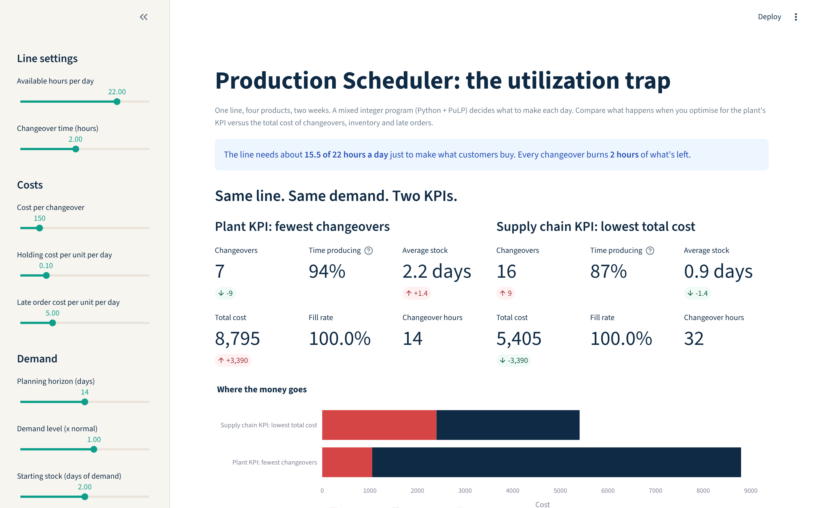

# Production Scheduler: the utilization trap

An interactive production planning app that shows what happens when a factory optimises for the wrong KPI.

One line makes four products over two weeks. A mixed integer program decides what to make each day, then solves the same problem twice:

| | Plant KPI: fewest changeovers | Supply chain KPI: lowest total cost |
|---|---|---|
| Changeovers | 7 | 16 |
| Time producing (vs changing over) | 94% | 87% |
| Average stock | 2.2 days | 0.9 days |
| Total cost | 8,795 | 5,405 |

*Default settings, synthetic data. Results vary slightly with the solver time limit.*

The plant's schedule looks better on the shop floor: fewer changeovers, more time producing. It also carries more than twice the stock and costs over 60% more. **The optimiser picks whatever trade-off your KPI tells it to.**



## What you can play with

- Changeover time, changeover cost, holding cost, late order cost
- Hours available per day, demand level, starting stock, planning horizon
- Upload your own demand as a CSV (rows = days, columns = products)

Every change re-solves both schedules, so you can watch the trade-off move. For example, cut the changeover time from 2 hours to 30 minutes and see how the cost-optimal plan switches to short, frequent runs.

## The model

A capacitated lot-sizing problem with setup carryover.

**Decision variables** for each product *p* and day *t*

- `x[p,t]` units produced
- `y[p,t]` 1 if the line changes over to *p* on day *t*
- `w[p,t]` 1 if the line starts day *t* already set up for *p* (carried over, no changeover needed)
- `I[p,t]` stock at the end of the day, `B[p,t]` units late

**Constraints**

- Flow balance: `I[p,t-1] - B[p,t-1] + x[p,t] - demand[p,t] = I[p,t] - B[p,t]`
- Capacity: `sum(x[p,t] / rate[p]) + setup_hours * sum(y[p,t]) <= hours_per_day`
- Produce only when set up: `x[p,t] <= M[p,t] * (y[p,t] + w[p,t])`
- Carryover: at most one product carried into a day, only if it ran the day before
- End of horizon: finish with at least the starting stock (stops the plan from "winning" by emptying the warehouse)

**Objectives**

- Plant KPI: meet demand, then minimise the number of changeovers. Stock is almost invisible to it.
- Supply chain KPI: minimise `changeover cost + holding cost + late order cost`.

Solved with the open-source CBC solver through PuLP, with an 8 second time limit and a 3% optimality gap so the app stays responsive.

## Run it

```bash
git clone https://github.com/zain-nadeem786/production-scheduler.git
cd production-scheduler
python -m venv .venv
source .venv/bin/activate        # Windows: .venv\Scripts\activate
pip install -r requirements.txt
streamlit run app.py
```

Run the tests with `pytest`.

## Project layout

```
app.py                  Streamlit app
scheduler/model.py      MIP model, KPIs and Gantt helper
scheduler/data.py       synthetic demand generator
tests/test_model.py     capacity, carryover and objective checks
```

## Limitations and next steps

- One line, sequence-independent changeovers. Real lines often have sequence-dependent setups (light to dark colours, allergen cleans).
- Deterministic demand. A natural next step is adding safety stock targets or scenario-based demand.
- Daily buckets. Shift-level buckets would give a more precise sequence.

All data is synthetic. Built by Zain Nadeem.
